`ssoossh-nss` gives a Linux host its users and groups from the directory
`ssoosshd` already reads. `getent passwd alice`, `id alice`, `ls -l` and an
`sshd` login all resolve a directory account by name or number -- uid,
primary gid, every group membership, home, shell and display name -- without
an `/etc/passwd` line, an sssd configuration or anything else provisioned
per host. An ephemeral host booted from an image has a working directory at
once; a long-lived one keeps a persistent cache and stops asking the server.

It answers one question: **what POSIX identity is this name.** It never
answers "may this person log in". That stays with SSH certificates:
`TrustedUserCAKeys`, the certificate's principals and the principals
mapping decide who gets in (see [Trusting the CA in sshd](/ssoossh/hosts/sshd-trust/)),
and `pam_ssoossh` decides `sudo` and the rest. A name that resolves here but
holds no certificate is an account nobody can log in to through ssoossh.
Nothing on this page issues or validates a certificate.

The server side has to be on first: [the NSS directory](/ssoossh/operations/nss/)
covers `nss.enabled`, the directory sync and the fleet keys a host presents.

## How a lookup reaches the server

```mermaid
flowchart LR
    accTitle: How a host resolves a directory user through ssoossh-nss
    accDescr {
      A process on the host, such as sshd, sudo or ls, calls glibc, which
      loads nss-systemd, the NSS module systemd ships. nss-systemd queries
      every socket in /run/systemd/userdb/, among them
      com.github.mnestor.ssoossh, which systemd holds for ssoossh-nss. The
      daemon answers from its cache when it can and otherwise asks ssoosshd
      over HTTPS, pinned to a private CA or a public key and authenticated by
      the fleet key. ssoosshd answers from the POSIX rows its directory sync
      keeps.
    }
    Caller["sshd, sudo, id, ls"] --> Glibc["glibc"]
    Glibc --> Mod["nss-systemd<br/>(systemd's module)"]
    Mod -->|"varlink on /run/systemd/userdb/<br/>com.github.mnestor.ssoossh"| Daemon["ssoossh-nss<br/>cache and host policy"]
    Daemon -->|"pinned HTTPS + fleet key"| Server["ssoosshd<br/>/api/nss/*"]
    Server --> Dir[("POSIX rows from<br/>the directory sync")]
```



The module that runs inside `sudo`, `sshd` and every other caller is
`nss-systemd`, which systemd ships and most hosts already load. ssoossh
installs no NSS module of its own. `ssoossh-nss` implements systemd's
documented `io.systemd.UserDatabase` interface; the
[architecture page](/ssoossh/internals/architecture/#the-nss-directory-beside-the-pipeline)
says why.

## Platform floor

- **systemd 245 or later**, the release that brought userdb. The oldest in
  the measured set is Ubuntu 20.04's 245.4.
- **glibc.** musl cannot load NSS modules, and Alpine has no systemd, so no
  `.apk` is built.
- **`systemd` on the `passwd:`, `group:` and `shadow:` lines** of
  `/etc/nsswitch.conf`.

RHEL 8 (systemd 239) and Alpine are out of scope.

The `shadow:` line is not optional. `nss-systemd` always gives a userdb
account the password field `x`, so the shadow entry is where the account's
lock lives. Without `systemd` on `shadow:` -- measured on AlmaLinux 9 as
shipped -- `sshd` with `UsePAM yes` refuses **every** directory user
(`pam_unix`'s account check finds no shadow entry), and with `UsePAM no` it
admits a **locked** one.

What each distribution ships, measured on 2026-10-17 in clean images and on
AlmaLinux 9.8 and 10.2:

| Distribution | systemd | `passwd:` and `group:` | `shadow:` | What to change |
| --- | --- | --- | --- | --- |
| Debian 12, 13 | 252, 257 | `files systemd` once `libnss-systemd` is installed | `files systemd` likewise | nothing, usually (see below) |
| Ubuntu 20.04, 22.04 | 245, 249 | `files systemd` once `libnss-systemd` is installed | `files` | add `systemd` to `shadow:` |
| Ubuntu 24.04 | 255 | `files systemd` once `libnss-systemd` is installed | `files systemd` likewise | nothing, usually |
| RHEL, Alma, Rocky 9 | 252 | `systemd` listed | `files`, in every authselect profile | add `systemd` to `shadow:` |
| RHEL, Alma, Rocky 10, Fedora 44 | 257, 259 | `systemd` listed | `files systemd` | nothing |
| Arch | 262 | `systemd` listed | `files systemd` | nothing |
| openSUSE Leap 15.6 | 254 | `compat` | `compat` | add `systemd` to all three, and see [nscd](#nscd-and-unscd) |

`libnss-systemd` is a dependency of the `.deb`, and its install script adds
`systemd` to the file. On Debian 12 and later and Ubuntu 24.04 it does so
only on its first install, and only when no line mentions `systemd` yet, so
a host whose file was hand-edited to a partial entry stays partial. `compat`
on Leap does not imply `systemd`; the line has to name it:

```text
passwd: compat systemd
group:  compat systemd
shadow: compat systemd
```

On a host where authselect owns `/etc/nsswitch.conf` (`authselect current`
names a profile), make the edit in `/etc/authselect/user-nsswitch.conf` and
run `authselect apply-changes`, or the next `authselect select` writes it
back.

You do not have to remember any of this. The daemon reads
`/etc/nsswitch.conf` at every start and logs an error for each of the three
lines that lacks `systemd` ("nsswitch.conf will not consult this daemon;
directory users will look missing"), and `ssoossh-nss status` reports the
same and exits non-zero. A missing entry otherwise looks exactly like
missing users. The package never edits the file: whether the host consults
userdb is your decision.

## Install

From the [package repository](/ssoossh/packages/):

```bash
# RHEL, Alma, Rocky, Fedora: ssoossh-nss-selinux comes with it as a weak dependency
sudo dnf install ssoossh-nss

# Debian, Ubuntu: pulls in libnss-systemd
sudo apt install ssoossh-nss
```

The package installs the daemon at `/usr/sbin/ssoossh-nss`, its two units,
the man pages and an example `/etc/ssoossh/nss.yaml` with every option
commented out at its default. It enables nothing, starts nothing and never
touches `nsswitch.conf`: as shipped the daemon refuses to start, because it
has no trust root until you give it one. See
[Installing from packages](/ssoossh/packages/#the-nss-daemon) for the
dependencies.

## Configure

Four steps, the same on every host. In an image, do them once in the image.

**1. Get a fleet key.** Someone who administers fleet keys creates one on the
server (see [fleet keys](/ssoossh/operations/nss/#fleet-keys)); the secret is
shown once. One key serves a whole fleet, or one environment of it. It is a
shared credential, like an LDAP bind account; the
[security model](/ssoossh/concepts/security-model/#the-nss-fleet-key) says
what that exposes.

**2. Write the key file.** `/etc/ssoossh/nss.key`, owned by root, mode
`0600`, holding exactly two lines, the key id and then the secret:

```bash
sudo install -m 0600 -o root -g root /dev/null /etc/ssoossh/nss.key
sudo tee /etc/ssoossh/nss.key >/dev/null <<'EOF'
nss_k7m4qp2x
ssoossh_nss_<the secret the server showed>
EOF
```

The daemon refuses a key file, like `nss.yaml` itself, that is not a regular
file, that has any group or other permission bit, or (when it runs as root)
that root does not own. Blank lines around the two are ignored; a third line
is an error. Error messages give the line count, never the content.

**3. Point it at the server.** In `/etc/ssoossh/nss.yaml`, set `server` and
one trust root: a key pin, as below, a CA bundle in `tls_ca_file`, or
`tls_ca_file: system` for the host's own trust store (see
[Server certificates from a public CA](#server-certificates-from-a-public-ca)).
There is no default: with neither set the daemon refuses to start. It trusts
only what you name there, and proxy variables are ignored:

```yaml
server: https://ssh.example.com
# The SHA-256 of the server's public key, base64 (standard encoding)
tls_spki_pin:
  - "q4Sx0rkS2Vb1l0c8zGfNnxCwV2P6s0bRHq0vYb6cJpA="
```

Take the pin from the running server:

```bash
openssl s_client -connect ssh.example.com:443 -servername ssh.example.com </dev/null 2>/dev/null |
  openssl x509 -pubkey -noout |
  openssl pkey -pubin -outform der |
  openssl dgst -sha256 -binary | base64
```

A pin names the server's key, not its certificate, so a certificate renewed
on the same key keeps matching; list the next key's pin beside the current
one before the server moves to it. With pins alone the key is the whole
check. Set `tls_ca_file` to a CA bundle (or to `system`) instead to verify the
chain and the server name, or set both, and the certificate must chain to that
CA *and* carry a pinned key. Connections are TLS 1.3 only. `ssoossh-nss
status` names the trust in force on its `trust:` line, and when the pin does
not match, its error names the digest the server presented.

### Server certificates from a public CA

A key pin suits a certificate whose key you control and keep. Most ACME
clients make a new key at every renewal (certbot does unless it runs with
`--reuse-key`), so a pin on a Let's Encrypt certificate breaks every 60 to 90
days. For a certificate from a public CA, trust that CA's roots with
`tls_ca_file` instead: the chain and the server name are both checked, and
renewals and the CA's changes of intermediate keep working. Any certificate
that CA issues for the server's name is accepted, which is less than a key
pin and much less than the whole system trust store.

Do not pin an intermediate. Public CAs rotate them, and `tls_spki_pin`
matches the server's own certificate only.

**Find which root the server's chain leads to.** The last `i:` line names it:

```bash
openssl s_client -connect ssh.example.com:443 -servername ssh.example.com </dev/null 2>/dev/null |
  sed -n '/^Certificate chain/,/^---/p'
```

For Let's Encrypt it is ISRG Root X1 or ISRG Root X2, or one of the newer
roots, Root YR and Root YE, which X1 and X2 cross-sign. Bundle all four, so a
chain that moves to the newer roots, or drops a cross-sign, still verifies.

**Fetch the roots**, each into its own file first so each can be checked:

```bash
mkdir -p /root/isrg && cd /root/isrg
for f in isrgrootx1.pem isrg-root-x2.pem gen-y/root-yr.pem gen-y/root-ye.pem \
         gen-y/root-yr-by-x1.pem gen-y/root-ye-by-x2.pem; do
  curl -fsS -o "$(basename "$f")" "https://letsencrypt.org/certs/$f"
done
```

**Check them before trusting them.** The download already rode on your
system trust store; these checks do not depend on it.

```bash
# Subject, expiry and SHA-256 fingerprint of each root:
for f in isrgrootx1.pem isrg-root-x2.pem root-yr.pem root-ye.pem; do
  openssl x509 -in "$f" -noout -subject -enddate -fingerprint -sha256
done

# X1 and X2 are in every distribution's trust store; on Debian and Ubuntu
# compare with those copies (no output means identical):
cmp <(openssl x509 -in isrgrootx1.pem -outform der) \
    <(openssl x509 -in /usr/share/ca-certificates/mozilla/ISRG_Root_X1.crt -outform der)
cmp <(openssl x509 -in isrg-root-x2.pem -outform der) \
    <(openssl x509 -in /usr/share/ca-certificates/mozilla/ISRG_Root_X2.crt -outform der)

# Root YR and Root YE are newer than most trust stores: check that X1 and X2
# vouch for their keys, then that the self-signed roots carry the same keys.
openssl verify -no-CApath -no-CAstore -CAfile isrgrootx1.pem root-yr-by-x1.pem
openssl verify -no-CApath -no-CAstore -CAfile isrg-root-x2.pem root-ye-by-x2.pem
[ "$(openssl x509 -in root-yr.pem -noout -pubkey)" = "$(openssl x509 -in root-yr-by-x1.pem -noout -pubkey)" ] && echo "Root YR key matches"
[ "$(openssl x509 -in root-ye.pem -noout -pubkey)" = "$(openssl x509 -in root-ye-by-x2.pem -noout -pubkey)" ] && echo "Root YE key matches"
```

At the time of writing the fingerprints are:

| Root | Expires | SHA-256 fingerprint |
| --- | --- | --- |
| ISRG Root X1 | 2035-06-04 | `96:BC:EC:06:26:49:76:F3:74:60:77:9A:CF:28:C5:A7:CF:E8:A3:C0:AA:E1:1A:8F:FC:EE:05:C0:BD:DF:08:C6` |
| ISRG Root X2 | 2040-09-17 | `69:72:9B:8E:15:A8:6E:FC:17:7A:57:AF:B7:17:1D:FC:64:AD:D2:8C:2F:CA:8C:F1:50:7E:34:45:3C:CB:14:70` |
| Root YR | 2045-09-02 | `E5:7B:7E:6F:15:0C:41:91:02:E8:D5:C0:55:72:9F:F9:67:B9:D1:A8:29:BF:00:CE:C8:9C:A6:04:EB:F4:A8:6F` |
| Root YE | 2045-09-02 | `E1:4F:FC:AD:5B:00:25:73:10:06:CA:A4:3A:12:1A:22:D8:E9:70:0F:4F:B9:CF:85:2F:02:A7:08:AA:5D:56:66` |

**Install the bundle and test it against the server** with nothing else
trusted. `openssl` needs `-no-CApath -no-CAstore`, and `curl` an empty
`--capath`, or both quietly fall back to the system store and pass anyway:

```bash
cat isrgrootx1.pem isrg-root-x2.pem root-yr.pem root-ye.pem > /etc/ssoossh/isrg-roots.pem
chmod 644 /etc/ssoossh/isrg-roots.pem

openssl s_client -connect ssh.example.com:443 -servername ssh.example.com \
  -CAfile /etc/ssoossh/isrg-roots.pem -no-CApath -no-CAstore -verify_return_error </dev/null 2>&1 |
  grep 'Verify return code'          # Verify return code: 0 (ok)

mkdir -p /tmp/no-ca && curl -sS --cacert /etc/ssoossh/isrg-roots.pem --capath /tmp/no-ca \
  -o /dev/null -w '%{http_code}\n' https://ssh.example.com/api/version   # 200
```

Then set it in `nss.yaml` and restart the daemon, which reads the bundle when
it connects to the server:

```yaml
server: https://ssh.example.com
tls_ca_file: /etc/ssoossh/isrg-roots.pem
```

**The system trust store** is the weakest choice: every CA the host trusts,
including any TLS-inspection root a company installs, can then answer for the
server, and so decide which uid a name maps to on this host. If you accept
that, say so explicitly:

```yaml
server: https://ssh.example.com
tls_ca_file: system
```

`system` is a word, not a path, and only in lower case; `System` is refused.
The daemon logs a warning at every start while it is set without a pin, and
`status` shows `trust: system store (any CA this host trusts)`. The chain and
the server name are checked against the store Go finds on the host, TLS 1.3
is still the minimum, and proxy variables are still ignored. Add
`tls_spki_pin` as well and both must hold.

Unlike a CA file, `system` honours `SSL_CERT_FILE` and `SSL_CERT_DIR` from the
daemon's own environment, which replace the distribution's bundle. Under
systemd that is the unit's environment, not your shell's; the shipped unit
sets neither, so a drop-in that sets one changes what the daemon trusts.

Pointing `tls_ca_file` at the distribution's bundle path
(`/etc/ssl/certs/ca-certificates.crt` on Debian and Ubuntu,
`/etc/pki/tls/certs/ca-bundle.crt` on EL and Fedora) still works and trusts
the same CAs, but `system` finds the bundle on any distribution. Either way,
the store is read once, when the daemon starts: restart it after the
distribution updates the store.

`server` is required. The daemon talks to that one URL only. For failover,
put several `ssoosshd` servers behind a load balancer and set `server` to its
URL.

**4. Enable the socket, not the service.**

```bash
sudo systemctl enable --now ssoossh-nss.socket
```

systemd holds `/run/systemd/userdb/com.github.mnestor.ssoossh` and starts the
daemon at the first lookup. `systemctl enable ssoossh-nss.service` enables
the socket too. Then check it:

```bash
sudo ssoossh-nss status
getent passwd alice
id alice
```

## SELinux on EL hosts

On an enforcing RHEL, Alma, Rocky or Fedora host, install
`ssoossh-nss-selinux` (dnf does, as a weak dependency of `ssoossh-nss`).
Without it the daemon runs as `unconfined_service_t`, and **no confined
caller can reach its socket**: systemd labels the listening socket with the
daemon's domain, and `nsswitch_domain`, the attribute every confined
user-resolving domain carries, may not connect to that type. `sshd` logs
`Invalid user` for every directory user, and on EL10, where
`systemd-userwork` makes the per-group lookups of `initgroups`, a directory
user's supplementary groups drop out with no error at all.

The module gives the daemon its own domain, `ssoossh_nss_t`, labels its
files, and adds the one rule every caller needs:

```text
allow nsswitch_domain ssoossh_nss_t:unix_stream_socket connectto;
```

It loads at priority 200 (the vendor slot, so a site module of the same name
at 400 wins), relabels the daemon's files, and on a first install restarts
the socket if it is running, so the next lookup starts the daemon confined.
One module serves EL9 and EL10. It needs `policycoreutils` and
`selinux-policy-targeted` 38.1.75 or later. The daemon may connect to the
ports the base policy calls HTTP (443, 8443 and the rest); an `ssoosshd`
elsewhere needs its port labelled:

```bash
sudo semanage port -a -t http_port_t -p tcp 9443
```

`ps -eZ | grep ssoossh-nss` should show `ssoossh_nss_t`. The policy source
ships under `/usr/share/doc/ssoossh-nss-selinux/` for a site that builds its
own.

## Home directories

No distribution measured puts `pam_mkhomedir` or `pam_oddjob_mkhomedir` in
`sshd`'s PAM session stack, and `pam_ssoossh` implements `auth` only, so a
directory user's first login otherwise lands with no home directory. Turn
home creation on:

| Distribution | How |
| --- | --- |
| Debian, Ubuntu | `sudo pam-auth-update --enable mkhomedir` (the profile ships, set to off) |
| RHEL, Alma, Rocky, Fedora | `sudo dnf install oddjob-mkhomedir`, `sudo authselect enable-feature with-mkhomedir`, `sudo systemctl enable --now oddjobd` |
| Others | `session required pam_mkhomedir.so skel=/etc/skel umask=0077` in the session stack `sshd` includes |

On SELinux hosts prefer `oddjob-mkhomedir`, which creates the directory from
its own service rather than from inside the confined `sshd`.

## nscd and unscd

Neither may cache `passwd` or `group`. Both sit in front of NSS and remember
"not found": a lookup the daemon could not answer in time (see
[below](#what-to-expect)) would be cached as a miss, and a cached positive
entry hides a lock or a group change from the daemon's own refresh rules.

openSUSE Leap is the one target where this bites by default: its
`enhanced_base` pattern recommends `nscd`, a preset enables it, and its
configuration caches both. nscd is not installed by default on Debian,
Ubuntu or EL9, and does not exist on EL10, Fedora or Arch. Where it runs,
turn the two caches off in `/etc/nscd.conf` and restart it, or disable it:

```text
enable-cache passwd no
enable-cache group  no
```

`ssoossh-nss status` warns whenever a process named `nscd` or `unscd` is
running. It cannot see their configuration, so it warns either way.

## What to expect

**An outage looks like "user not found".** `nss-systemd` asks every userdb
service in parallel, and a service that is not available reaches the caller
as not found. The daemon serves its cache while the server is unreachable,
for as long as `cache_expire_offline` allows (for ever, by default), and in
persistent mode across a reboot. So an outage costs only the names this host
has never resolved. A daemon that cannot start is restarted a few times and
then given up on (five starts within a minute); after that every lookup is a
quick not found until the cause is fixed and
`systemctl reset-failed ssoossh-nss.socket ssoossh-nss.service` brings the
socket back.

**A first login while the server is slow can fail once.** Every call is
answered within `socket_answer_deadline` (2.5 s). A fetch still running then
carries on into the cache, and the caller is told the service is not
available, which it sees as not found. The retry finds the cache filled. The
deadline exists because systemd's own call timeout is 45 s, and a service
that does not answer holds every lookup on the host that long, local users
included.

**A flood of connections cannot take lookups away from root.** The
daemon serves at most `socket_max_connections` (1024) userdb connections at
once and keeps a quarter of them for uid 0 callers: `sshd`, `logind`,
`sudo` and `su` (setuid, so uid 0 when they connect) and
`systemd-userdbd`'s workers. A local user who opens connections and holds
them can fill only the rest; logins and `sudo` keep resolving directory
users. A connection over the cap is answered "service not available",
which its caller sees as not found, and the journal says so at most once a
minute, with how many were refused since the last line and the uid of the
latest:

```json
{"level":"WARN","msg":"userdb connections over socket_max_connections refused; their lookups were answered ServiceNotAvailable, which callers see as not found","refused":5120,"unanswered":0,"last_uid":1001,"max_connections":1024,"reserved_for_uid_0":256}
```

`unanswered` counts connections closed without an answer because 64
refusals were already running; their callers see the same not found. A
connection that keeps sending calls is closed once it has spent
`socket_idle_timeout` (10 s) in all waiting for them; a call being
answered, a slow first fetch included, is never cut. Legitimate callers
open a connection per lookup and close it after the answer, so neither
limit is near anything they do. The line names a uid, not a process:
`ps -u <uid>` lists what that uid runs.

**Disabled and deleted users are locked.** The server marks an account
disabled when ssoossh disables the person (an admin, SOC, or the LDAP sync),
when the directory's own disabled flag says so
([`nss.disabled_filter`](/ssoossh/reference/config/nss/#disabled_filter)), or
deleted when the entry has been missing long enough. The host keeps the
name, uid, gid and home, serves the record locked, and replaces the shell
with `disabled_shell` (`/usr/sbin/nologin`). With `systemd` on `shadow:`, a
locked record has an expired shadow entry, and `sshd` refuses it under both
`UsePAM` settings: `pam_unix` reports the account expired with `UsePAM yes`,
and `sshd`'s own check refuses it as locked with `UsePAM no` (measured on
AlmaLinux 9.8 and 10.2). A session that is already open is not ended.

**Group changes reach a host at the next `sshd` login, or as the cache
ages.** The server picks a directory change up at its next sync
([`nss.sync_interval`](/ssoossh/reference/config/nss/#sync_interval), 15
minutes). On the host, when `sshd` looks a user up and the cached entry is
older than `login_soft_ttl` (60 s), the daemon refreshes it first, within
`login_refresh_timeout` (1 s), so a group removed in the directory is gone at
that login. `ssoossh host principals`, run by `sshd` as
`AuthorizedPrincipalsCommand`, also sends the daemon a one-way refresh hint
for the user. Otherwise an entry is answered from the cache for half its
lifetime (`entry_cache_nowait_percentage`), refreshed in the background after
that, and expires at `entry_cache_timeout` (90 minutes); in persistent mode a
background sweep refreshes ageing entries as well.

**A user's groups and a group's members are kept in step** *(added
2026-10-18)*. Both the user record (`id alice`) and the group record
(`getent group devs`) say who is in a group, and each is cached on its own
lifetime. When the daemon fetches a user in a group whose cached member
list lacks them, or no longer in a group whose cached list still names
them, it marks that group stale, and the next lookup of the group fetches
it again; the same holds the other way round, for users added to or removed
from a group fetched fresh. So after `id alice` shows a group, `getent
group` for it lists alice on its next lookup rather than after the group's
own lifetime, even when the group was cached before the server knew of the
membership. Where the server itself keeps the two apart (under
`nss.auto_private_groups: true` it puts the directory primary group in a
user's groups without listing the user as a member), the daemon refetches
the group once, sees the server still says so, and stops asking until that
group's member list changes. A stale entry is still answered while the
server is unreachable.

**`sudo` in an open session uses the host cache.** Only `sshd` triggers the
synchronous refresh; `sudo`, `su` and everything else are answered from the
cache, and the session's own group list was set at login. To make a change
take effect now, `sudo ssoossh-nss cache -u alice` marks the entry stale.

**Local accounts always win.** A name or id present in `/etc/passwd` or
`/etc/group` is never served and never sent to the server, and a directory
user whose uid a local account already uses is refused. `root` is in
`filter_users` and `filter_groups`, and `min_id` (1000, never below 1) keeps
every system id out of reach. systemd's own ranges above 1000 need `max_id`
(see [Choosing min_id and max_id](#choosing-min_id-and-max_id)).

**Group memberships match on gid, never on name.** systemd hands a
membership to glibc as a group name, and glibc looks that name up in
`/etc/group` first. So for each of a user's directory groups the daemon
decides by gid, first match wins:

1. a gid outside `min_id..max_id` is dropped, as the group itself is not
   served (`status` lists it under `refused`);
2. a gid a local group has is listed under the local group's name, so the
   user gets that same gid (unless `filter_groups` lists that name);
3. a name a local group has, with another gid, is a **name collision**: it
   is dropped, and the daemon logs a warning once;
4. an invalid name, or one in `filter_groups`, is dropped;
5. anything else is listed under its directory name.

A directory group can therefore never hand out a local group by name: a
directory `wheel` or `docker` with its own gid does not make its members
members of the local one. A membership in a local system group such as
`sudo` (gid 27) is not granted from the directory either, since that gid is
below `min_id`; list those users in `/etc/group`, or grant the right to a
directory group with its own gid instead (a sudoers `%devs` rule, for
example). `require_groups` is checked against the memberships these rules
keep, by directory name, so a colliding or refused group never satisfies it.

**A group name collision leaves the directory group unresolved on this
host.** When the directory has `users` with gid 2005 and `/etc/group` has
`users` with gid 100, the daemon logs, once per daemon run:

```json
{"level":"WARN","msg":"a directory group has the same name as a local group; it is not resolved on this host: its members do not get its gid here, files owned by its gid show the number, and the local group is unaffected. Rename one of the two to fix it","group":"users","gid":2005,"local_gid":100}
```

The members get neither gid 2005 nor gid 100, `ls -l` shows files owned by
gid 2005 as the number, and the local `users` keeps its own members.
`ssoossh-nss status` lists the collisions met since the daemon started
(twenty, then a count of the rest):

```text
collisions:    1 group name collision (a directory group with a local group's name; not resolved here, rename one of the two)
  users: directory gid 2005, local gid 100, first seen 2026-10-18T09:00:00Z
```

The fix is to rename one of the two groups, in the directory or on the host.
A SIGHUP clears the list, and anything still colliding is logged and listed
again the next time a lookup meets it.

**A uid or gid never moves on its own.** The server holds a changed number
as pending until an admin accepts it, so re-own the files on hosts first;
see [frozen ids](/ssoossh/operations/nss/#frozen-uid-and-gid). When a refresh
does change a cached name's uid or gid, the daemon logs a warning with both
numbers, so the change is visible in the journal of every host it reached.

## Shells and overrides

A user's shell is the first acceptable one of: `override_shell`, the
directory's shell (or a host override's, below), and finally
`shell_fallback`, which is used even when nothing else is acceptable.
Acceptable means listed in `allowed_shells` (or in `/etc/shells` when that
is empty) and not in `vetoed_shells`. Users do not choose their own shell:
it comes from the directory and this host's policy only. The home is the
first absolute path of `override_homedir`, the directory's home and
`fallback_homedir`.

The per-user shell choice and its `shell_map` option were removed on
2026-10-18 after the threat review: the shell comes from the directory and
host policy only. `nss.yaml` refuses unknown keys, so a file that still sets
`shell_map` no longer loads; delete the line.

One user can be given a different uid, gid, home or shell on this host only:

```bash
sudo ssoossh-nss override set alice --shell /bin/zsh --home /data/alice
sudo ssoossh-nss override list
sudo ssoossh-nss override unset alice
```

The overrides live in `/etc/ssoossh/nss-overrides.yaml`, keyed by account
name like `principals.yaml`. The command rewrites the file atomically and
tells the running daemon to re-read it; no cache flush is needed, because
overrides apply as entries are read. An override uid or gid outside
`min_id..max_id` is refused, and a host override shell replaces the
directory's. The file must not be group- or world-writable. A broken file refuses
the daemon's start; once it is running, a later broken edit keeps the last
good overrides.

## nss.yaml reference

`/etc/ssoossh/nss.yaml`, root-owned and `0600`. Only the file is read: the
environment is never consulted. An option the daemon does not know is an
error, so a misspelling stops the start instead of being ignored. Durations
take Go duration strings (`90s`, `1h30m`) or, as `sssd.conf` counts, a bare
number of seconds. Option names follow `sssd.conf(5)`. The defaults below
are the ones the shipped example lists and the daemon uses; a test keeps the
three in step.

### Server

| Option | Default | Meaning |
| --- | --- | --- |
| `server` | `""` | the `ssoosshd` https URL, e.g. `https://sso.example.com`; required. For failover, name a load balancer's URL |
| `tls_ca_file` | `""` | a CA bundle (PEM) the server's certificate must chain to, a private CA or a public CA's roots, or `system` (exactly, lower case) for the host's system trust store, which also honours `SSL_CERT_FILE` and `SSL_CERT_DIR` from the daemon's environment ([public CAs](#server-certificates-from-a-public-ca)); this or `tls_spki_pin` is required |
| `tls_spki_pin` | `[]` | base64 SHA-256 digests of the server's SubjectPublicKeyInfo; with `tls_ca_file` as well, both must hold |
| `api_key_file` | `/etc/ssoossh/nss.key` | the fleet key: line 1 the key id, line 2 the secret, root-only |
| `timeout` | `5s` | bounds one upstream lookup, retries included. Each attempt but the last gets at most half of what is left, and no more than `socket_answer_deadline` less a second (1.5 s by default), so a retry still answers the caller in time |
| `reconnection_retries` | `3` | further attempts after a transport failure, a short pause apart, before the daemon counts the server as offline |
| `offline_timeout` | `60s` | the first wait before probing an offline server again; it doubles after each failed probe, up to an hour |
| `socket_answer_deadline` | `2.5s` | how long a userdb call may take to answer; must stay under 45 s, systemd's own call timeout |
| `socket_max_connections` | `1024` | the most userdb connections served at once; a quarter of them only uid 0 callers may take, and one over the cap is answered "service not available" ([what over the cap looks like](#what-to-expect)); at least 4. The unit's `LimitNOFILE`, `MemoryMax` and `TasksMax` are sized for 1024 |
| `socket_idle_timeout` | `10s` | the total time a userdb connection may spend waiting for calls, over its whole life; a call never resets it, and a call being answered never counts against it; at least 1 s |

### Cache

| Option | Default | Meaning |
| --- | --- | --- |
| `cache_mode` | `persistent` | `persistent` keeps the cache in `/var/lib/ssoossh-nss/cache.db` across restarts; `memory` keeps it in the daemon only |
| `entry_cache_timeout` | `90m` | how long a positive entry is valid (5400 s, sssd's default) |
| `entry_cache_user_timeout` | `0` | overrides `entry_cache_timeout` for users; 0 inherits it |
| `entry_cache_group_timeout` | `0` | the same for groups |
| `entry_negative_timeout` | `15s` | how long an authoritative "no such user or group" is remembered |
| `entry_cache_nowait_percentage` | `50` | the share of an entry's lifetime, in percent, during which it is answered without a refresh; after it the entry is still answered and refreshed in the background; 0 turns the background refresh off |
| `refresh_expired_interval` | `0` | the background sweep's period; 0 means 75% of the shorter entry lifetime in persistent mode, and no sweep in memory mode |
| `refresh_rate` | `2` | background upstream refreshes per second, at most |
| `cache_expire_offline` | `0` | how long after its fetch an entry may still be answered while the server is unreachable; 0 means for ever |

### sshd logins

| Option | Default | Meaning |
| --- | --- | --- |
| `login_soft_ttl` | `60s` | when `sshd` looks a user up and the entry is older than this, the daemon refreshes it first; also the per-name debounce of the refresh hint `ssoossh host principals` sends |
| `login_refresh_timeout` | `1s` | bounds that refresh; on timeout the cached entry is answered; must not exceed `socket_answer_deadline` |
| `sshd_units` | `[sshd.service, ssh.service, sshd@.service, ssh@.service]` | the systemd units `sshd` runs as; a uid 0 caller counts as `sshd` only when its cgroup is one of these, and `name@.service` matches every instance of a template |

### Ids, homes and shells

| Option | Default | Meaning |
| --- | --- | --- |
| `min_id` | `1000` | every uid and gid served is at least this; it cannot be 0, so the directory can never serve root |
| `max_id` | `0` | every uid and gid served is at most this; 0 means no upper bound, which leaves systemd's reserved ranges reachable (see [Choosing min_id and max_id](#choosing-min_id-and-max_id)) |
| `override_gid` | `0` | replaces every user's primary gid; applied after the range check, so it may name a shared group such as gid 100; 0 leaves the server's |
| `override_homedir` | `""` | replaces every home directory |
| `fallback_homedir` | `/home/%u` | the home when the server sends none; the homedir templates expand `%u` (name), `%U` (uid), `%h` (the server's home) and `%%`; any other `%` sequence is kept as written |
| `override_shell` | `""` | replaces every shell, if acceptable |
| `shell_fallback` | `/bin/sh` | the shell when no other candidate is acceptable, used even when it is not |
| `allowed_shells` | `[]` | the acceptable shells; empty means `/etc/shells` |
| `vetoed_shells` | `[]` | shells never acceptable |
| `disabled_shell` | `/usr/sbin/nologin` | the shell of a disabled or deleted account, which is also served locked; exempt from the shells checks, since Debian does not list `nologin` in `/etc/shells` |
| `ignore_group_members` | `false` | drops member lists from group answers; a user's own groups still resolve |
| `filter_users` | `[root]` | user names never served, however the server answers |
| `filter_groups` | `[root]` | group names never served |
| `require_groups` | `[]` | when set, only members of at least one of these groups are served |

### Choosing min_id and max_id

Set `min_id` and `max_id` to bracket the uids and gids your directory really
allocates, for example `min_id: 10000` and `max_id: 199999`. The default
`max_id: 0` has no upper bound, and beyond the range the only guard is the
local short-circuit: an id that `/etc/passwd` or `/etc/group` lists is never
served. systemd reserves ranges above 1000 for ids it creates at run time
through its own userdb services, not `/etc/passwd`, so the short-circuit
does not see them
([systemd `docs/UIDS-GIDS.md`](https://github.com/systemd/systemd/blob/838528104ba79fcf99aefa0a01613cbb1a7bc44f/docs/UIDS-GIDS.md)).
Under the default config a directory entry with an id in one of them is
served:

| Range | Owner | A directory entry there, default config |
| --- | --- | --- |
| 60001-60513 | `systemd-homed` home directories | served: homed users are not in `/etc/passwd` |
| 60514-60577 | host users mapped into `systemd-nspawn` containers | served |
| 60578-60705 | dynamic greeter users of display managers | served |
| 61184-65519 | `DynamicUser=` services | served: dynamic users are not in `/etc/passwd` |
| 65534 | `nobody` | refused when `/etc/passwd` and `/etc/group` list it, as Debian and Alma ship them; a directory membership with gid 65534 is listed as the local group (rule 2 above) |
| 65535 | 16-bit `(uid_t) -1`, not usable | served |
| 524288-1879048191 | per-container ranges of `systemd-nspawn`, whose users `systemd-machined` synthesizes | served: container uids are never in `/etc/passwd` |
| 2147352576-2147418111 | foreign OS images | served |
| 2147483648-4294967294 | reserved; some kernel code (`devpts`) mishandles ids from 2^31 | served |
| 4294967295 | 32-bit `(uid_t) -1`, invalid | a lookup by that number is refused; a record carrying it, looked up by name, passes the range check |

A directory id inside one of these ranges can be the same number systemd
gives a home, a service or a container user on that host, so one uid has
two names and each owns the other's files. The container range matters
most: directory allocations, such as FreeIPA's and those mapped from Active
Directory, often land inside it, and `systemd-nspawn` checks only the first
uid of each 65536-id block it picks. If a host runs `systemd-nspawn` or
`systemd-machined` containers, keep `max_id` below the lowest container base
in use (`max_id: 524287` keeps the whole range out). An id outside
`min_id..max_id` is not served; `status` lists the groups it refused.

## Commands

| Command | What it does |
| --- | --- |
| `ssoossh-nss status` | the connection state (online, offline, unauthorized or rate limited), the server, the trust in force (system store, CA file, key pin, or a trust root and a pin), the key id, the cache counts and the last error, from the running daemon, with any group name collisions and groups refused by `min_id..max_id` (twenty of each, then a count); then the `nsswitch.conf` check and the nscd warning. Exits non-zero when the daemon does not answer or a check fails |
| `ssoossh-nss lookup user NAME` | asks the userdb socket exactly as `nss-systemd` does and prints the JSON reply; `group NAME` and `memberships NAME` likewise |
| `ssoossh-nss cache -u NAME` | marks cached entries stale, like `sss_cache`: `-u`/`-g` one user or group, `-U`/`-G` every user or group, `-E` everything. Nothing is deleted, and a stale entry is still served while the server is unreachable |
| `ssoossh-nss override list\|set\|unset` | the host overrides, above |
| `ssoossh-nss run` | the daemon itself, which the service unit starts |

`status`, `cache` and `override set`/`unset` talk to the running daemon over
its admin socket, `/run/ssoossh-nss/admin.sock`, which only root may use.
The daemon reads `nss.yaml` once, at start: restart the service after
editing it. A SIGHUP (`sudo systemctl kill -s HUP ssoossh-nss.service`)
re-reads the host files and the fleet key and clears the offline backoff,
the unauthorized latch and the collisions and refused groups that `status`
lists; replacing the key file clears the latch on its own.
The daemon logs JSON lines to the journal (`journalctl -u ssoossh-nss`).

## Troubleshooting

Work from the host outwards:

```bash
sudo ssoossh-nss status                 # is the daemon up, online, and consulted?
sudo ssoossh-nss lookup user alice      # what does the daemon itself answer?
userdbctl user alice                     # what does systemd's userdb see?
getent passwd alice; id alice            # what does glibc see?
journalctl -u ssoossh-nss -n 50
```

`userdbctl` is not everywhere: EL9 and Ubuntu 20.04 and 22.04 do not ship
it. `ssoossh-nss lookup` asks the same socket and is always there.

| Symptom | Look at |
| --- | --- |
| Every directory user is unknown, and `status` reports `nsswitch.conf: FAILED` | add `systemd` to the lines it names ([platform floor](#platform-floor)) |
| `getent` works from a root shell, but `sshd` logs `Invalid user`, on an enforcing EL host | the SELinux module is missing or not loaded, so confined callers cannot reach the socket: `semodule -l \| grep ssoossh_nss`, then `ausearch -m avc -ts recent` |
| `getent` works, but `sshd` refuses every directory user with `UsePAM yes` | `shadow:` lacks `systemd` |
| `state: unauthorized` | the server refused the fleet key: revoked, expired, rotated past its grace, or mistyped. Fix `/etc/ssoossh/nss.key`; the next lookup retries |
| `state: offline` with a pin error | the server's key changed; the error names the digest it presented |
| The host flips to `state: offline` after quiet periods, with `no response within ... on a reused connection` in the log, and directory users stop resolving for a while | something between the host and the server (a firewall, NAT or load balancer) silently drops connections that sit idle. The daemon pings an idle HTTP/2 connection every 15 s and closes it when no answer comes within 5 s, and a lookup attempt that gets no answer is retried on a fresh connection, so this should now cost one slow lookup at most. If it persists, check the TCP state (idle) timeout of every stateful device on the path: the pings keep a flow alive only when that timeout is longer than 15 s, and a device that drops flows regardless of traffic needs fixing there |
| `state: rate_limited` | the server answered 429; the daemon waits out its `Retry-After` and serves the cache meanwhile |
| A user resolves on one host but not another | `status` on both, then the host policy: a local account of the same name or uid, `min_id`, `max_id`, `filter_users` and `require_groups` all refuse. A name refused before any upstream call is logged only at `debug` (`run --log-level debug`); a server answer the policy refuses is a warning naming the reason |
| A directory user lacks a directory group on one host, or files show a bare gid | a local group with the same name: `status` lists it under `collisions`, and the journal has the warning. Rename one of the two ([memberships match on gid](#what-to-expect)) |
| A directory user lacks a group whose gid is below `min_id` | expected: `status` lists it under `refused`; such a gid is never served |
| A removed group still works for someone already logged in | expected: see [what to expect](#what-to-expect) |
| Lookups hang for 45 s | the daemon is failing to start; `systemctl status ssoossh-nss` |
| Directory users are intermittently not found, and the journal has `userdb connections over socket_max_connections refused` | something holds many connections open: the line's `last_uid` names the uid. If it is legitimate load, raise `socket_max_connections`, and the unit's limits with it |

The server side of a refused lookup (a revoked key, an address outside the
allow list, a rate limit) is in the audit log; see
[the NSS directory](/ssoossh/operations/nss/#alerts).
