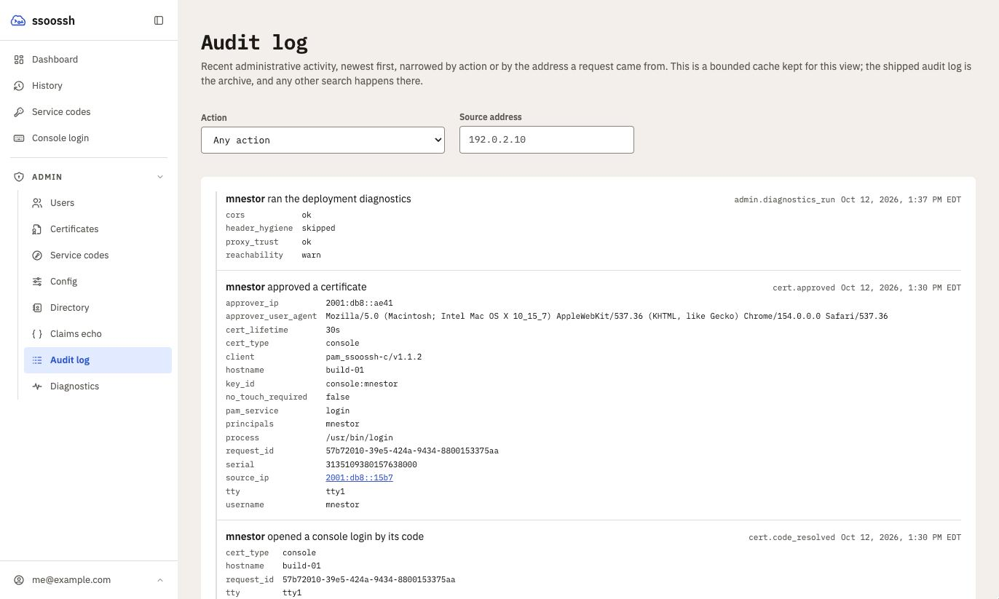

An ordered, append-only record of who did what, to whom, and when. It is not
the same thing as the certificate history: this is the administrative stream
-- logins, approvals, denials, containment actions, and privileged views.

## Two sinks, and they are not equals

Every event goes to both:

- **The shipped log** is the archive. A dedicated `type=audit` destination
  emits one JSON line per event, unconditionally, for an external log system
  to ship, retain, search and analyse. Real audit retention happens there.
- **The database table** is a bounded cache. It exists only to serve the web
  UI's recent-history views, so it is pruned on a schedule and is deliberately
  not searchable beyond its four indexed columns: the actor, the target, the
  action and the observed source address.

The consequence to hold onto: the log emit is unconditional because the table
copy is disposable. A deployment that configures no audit log destination
loses the archive, not the audit trail's correctness -- but it should
configure one.

Unconditional means unconditional: audit events are emitted at `INFO`, and
the shipped [`logging.level`](/ssoossh/reference/config/logging/#level) is
`WARN`, so the audit destination is held at an `INFO` floor when it has
neither a filename nor a
[`level`](/ssoossh/reference/config/audit/#logginglevel) of its own. Without
that floor an unconfigured deployment would discard every event rather than
merely fail to archive it. Setting `audit.logging.level` overrides the floor,
which is the point -- turning the trail down is an operator's call to make
deliberately, not one to arrive at by leaving a block empty.

```yaml
audit:
  retention: 1440h        # 60 days in the table; zero disables age pruning
  max_rows: 1000000       # safety valve behind retention; zero disables it
  sweep_interval: 1h      # how often the retention sweep runs
  logging:
    filename: /var/log/ssoossh/audit.log
    max_size: 100         # rotation, same keys as logging.* everywhere else
    max_backups: 30
    log_json: true
```

| Key | Default | Notes |
| --- | --- | --- |
| [`audit.retention`](/ssoossh/reference/config/audit/#retention) | `1440h` | how long an event stays in the table. Zero disables age-based pruning, leaving `max_rows` as the only bound |
| [`audit.max_rows`](/ssoossh/reference/config/audit/#max_rows) | `1000000` | the same sweep deletes oldest-first past the cap, whatever the action. Deliberately high: it bounds pathology, not ordinary volume. Zero disables it |
| [`audit.sweep_interval`](/ssoossh/reference/config/audit/#sweep_interval) | `1h` | pruning is not urgent, so this is measured in hours |
| [`audit.logging.*`](/ssoossh/reference/config/audit/#logging-1) | -- | the durable export. `log_json` defaults to `true` here |

Leave `audit.logging.filename` unset and audit records still reach the general
log; setting it splits them into their own rotating file.

`retention` bounds the UI's history, not the deployment's. A short window here
loses nothing that matters, because the shipped log is the archive.

One feature does read the table back. When the
[directory sync](/ssoossh/operations/ldap/#when-the-sync-disables-an-admin)
disables someone, it decides whether to email them as an admin from their
latest `auth.login` row in the last 60 days. A `retention` below 60 days, or a
`max_rows` cap that has trimmed those logins, shortens that window: an admin
whose last login the table no longer holds is not emailed. The sync logs the
window it actually had (`effective_window`) whenever it is under 60 days.

## Unauthenticated events and the row cap

Most events need a signed-in person or the server itself to happen.
`cert.request_refused_network` does not: anyone who can reach the server from a
refused network can raise one with a single unauthenticated request.

The sweep still treats these rows like any other: over `max_rows`, it deletes
the oldest rows first whatever their action, so the table always holds one
unbroken window of time. A large enough burst of refusals can therefore push
the oldest approvals, disables and logins out of the table, and so out of the
web UI's history. The shipped log keeps every line regardless; only the table
copy is trimmed.

The cap is a backstop, not a limit on the requests, and the table is not the
archive. Keep refused networks out at the firewall where you can, ship the
audit log to your log platform (Splunk or similar) so nothing depends on the
table copy, and for an internet-facing deployment keep
[`http.rate_limit`](/ssoossh/reference/config/http/#rate_limit)
on (it is on by default; zero turns it off) and leave
[`http.cert_request_rate_limit`](/ssoossh/reference/config/http/cert_request_rate_limit/)
in place, so one address cannot write refusals as fast as it can send.

## An audit row references nothing that can change

An entry must read the same in five years as it did the day it was written. A
foreign key breaks that: a rename changes what the entry appears to say, and a
deleted row makes it say nothing. So the payload carries literal snapshots --
the actor's subject, username and groups as they were at event time, and the
target's identity likewise -- and the row joins to nothing.

The `actor_user_id` and `target_user_id` columns exist solely so the UI can
ask "everything this account did" and "everything done to this account"
without a JSON scan. They are indexed grouping keys, never foreign keys and
never authoritative. If a user row is later deleted or renamed the timeline
still reads correctly from the payloads; the column merely stops matching.

The `action` column follows the same rule. It copies the payload's action so a
question about one action ("each user's latest `auth.login`") reads an index
instead of the JSON. The recorder writes the column and the payload from the
same event, so they agree, and the payload stays the record.

So does the `source_ip` column, which backs the feed's address filter. It
copies the payload's `detail.source_ip`, in canonical form (an IPv4-mapped
IPv6 address is stored as plain IPv4), and is empty for an event with no
source. See [Source addresses](#source-addresses) for which address that is.

One row serves both timelines. When a SOC analyst disables alice, the
analyst's history shows the disable and alice's page shows who did it and why,
from the same event.

## Mutations and their audit rows commit together

A state change appends its audit row **in the same transaction**, so a disable
without its audit row is unrepresentable. The in-process event bus is
deliberately not the write path: it is non-persistent, so a crash between
"user disabled" and "event consumed" would lose exactly the record an audit
log exists to keep.

View events have no transaction to join. They are a plain insert that must
never fail the read it describes, so an insert failure is logged loudly and
swallowed -- the shipped log line is still emitted, and that is the archive.

## Actions

Namespaced strings inside the payload, so the set grows without a migration. A
client must render an unknown action rather than assume the list is closed.

| Action | Notes |
| --- | --- |
| `auth.login` | Snapshots the groups the identity carried. Since membership is never persisted as authorization, this is the only durable record of what access an identity held on a given day |
| `auth.login_denied` | A disabled account attempting to log in, which otherwise vanishes entirely |
| `cert.requested`, `cert.approved`, `cert.denied` | |
| `cert.code_resolved` | A console code typed into the web UI and resolved to its request |
| `cert.claimed` | An approval link bound to the first browser that opened it; a later browser is sent to the "link already opened" page |
| `cert.expired` | A request that reached its deadline with nobody answering it. A system action, so it carries no actor |
| `cert.sign_failed` | A request approved but never signed: the signer reported a failure, or the sweep found it stranded |
| `cert.request_refused_network` | A certificate request refused because its source address is outside the type's `allowed_networks` (today only [`cert_options.console.allowed_networks`](/ssoossh/reference/config/cert_options/console/#allowed_networks)). A system action with no actor: nobody has signed in yet. The detail carries `cert_type`, `source_ip` and the reason; `source_ip` is the address the server observed (through `http.trusted_proxies`), never one the client supplied. The account and host the caller named are kept as `claimed_username` and `claimed_hostname`, never as an actor. One row per refusal, with no de-duplication, so a run of attempts from one place shows every time and source. The caller still gets the same 403, which does not say which networks are allowed, and nothing else is written. See [Unauthenticated events and the row cap](#unauthenticated-events-and-the-row-cap) |
| `cert.issued` | **Shipped log only.** The UI already has certificate history from the `certificates` table, so a table copy would be duplication; the archive line is the row an incident reviewer joins against target-host `sshd` logs |
| `enrollment.code_created`, `.redeemed`, `.expired` | Never carries the enrollment code: it is a bearer credential, and the never-log-sensitive-data rule covers payloads and log lines alike |
| `enrollment.notification_email_set` | Carries both the old and the new address. Redirecting where an enrollment's notifications go is also the quiet way to stop an account's holders hearing about their own credential, so "who changed it, and to what" is the question this exists to answer |
| `enrollment.reassigned` | **No longer emitted.** Group ownership removed enrollment transfer; the action stays defined so events recorded before that still read back with a name |
| `user.disabled`, `user.enabled` | |
| `user.auto_disabled` | A system action, so it carries no actor. Raised by the [LDAP sync](/ssoossh/operations/ldap/) |
| `user.disable_refused` | An admin or SOC analyst tried to disable their own account and the server refused. Actor and target are the same account, the reason is the server's own text, and `source_ip` is the address the server observed (through `http.trusted_proxies`), never one the client supplied. The account is left untouched. Only the self-disable refusal is recorded; other refused admin actions are not |
| `admin.enrollment_viewed` | One event per enrollment code opened. Not shipped-log only, unlike the two below: a code is a bearer credential, and it is one event per credential rather than one per screen |
| `admin.user_viewed`, `admin.audit_viewed` | **Shipped log only.** An auditor working through the directory generates one per user opened and one per page of the feed, and within a session they outnumber the decisions this log exists to record. They keep their archive line -- "who looked at this account" is a real question -- and lose the table copy the web UI renders. `admin.audit_viewed` also wrote a new row on every read of the feed, which shifted the window under the UI's "load more" while the feed paged by offset |
| `ldap.sync_triggered` | An admin running the [directory sync](/ssoossh/operations/ldap/) by hand, with the counts the pass produced. A dry run records `dry_run: true` and no change to go with it |
| `ldap.probed` | One directory probe, with the filter it sent and how many entries matched. The probe writes nothing, but it makes the server open an outbound connection and read an entry in full, which is worth a record |
| `admin.diagnostics_run` | One run of the [deployment diagnostics](/ssoossh/operations/diagnostics/), with the status each of the four checks returned. Like the probe it writes nothing and makes the server dial out, so it is recorded for the same reason |
| `admin.config_viewed` | **No longer emitted.** The effective-config screen is read-only and is reloaded constantly while an operator works, so the event arrived several times a minute and buried the decisions this log exists to record. The action stays defined so older events still read back with a name |

There is no logout event: sessions mostly end by expiry, so an explicit logout
carries too little signal to keep.

## Source addresses

`detail.source_ip` is always an address the server observed: the connection's
peer, or a forwarded address only when the peer is in
[`http.trusted_proxies`](/ssoossh/reference/config/http/#trusted_proxies).
Never one the client wrote into its request. It is also the one address the
`source_ip` column and the feed's address filter use, with one meaning on
every row: the client the event is about.

| Action | `source_ip` is |
| --- | --- |
| `cert.requested`, `cert.claimed`, `cert.approved`, `cert.denied`, `cert.expired`, `cert.sign_failed`, `enrollment.code_created` | the address the certificate request came from, recorded when it was created. Filtering on it follows one client's requests from request to outcome |
| `cert.request_refused_network` | the refused caller |
| `enrollment.redeemed` | the client that retrieved the service certificate |
| `user.disable_refused` | the browser that asked |
| every other action | absent, so the column is empty and no address filter matches the row |

Two other addresses appear in some payloads and are deliberately left out of
the column. `approver_ip`, on `cert.approved` and `cert.denied`, is the
approving browser: a different party, and mixing it in would make one filter
answer two questions. `remote_host`, in the host context, is what the client
reported, not an observation. Both stay in the payload and the shipped log.

Rows written before the column existed were backfilled from the payload as
their text was written. The recorder has always taken the address from the
connection, so that text is normally already canonical; a row whose stored
spelling differs (an IPv4-mapped address forwarded by a proxy, say) is not
matched by the filter, though its payload is unchanged.

Privileged **detail** views are audited; list views are not. Auditing list
pagination writes a row per page of the user directory and says nothing. If a
list query ever needs auditing, record it as one event carrying the search
parameters. `admin.audit_viewed` is one event per visit to the audit feed, not
one per event displayed, which settles the recursion question.

The web UI's audit view does not render `admin.user_viewed` or
`admin.audit_viewed` at all. The server no longer writes them to the table
that view reads, and the view drops any rows recorded before that change,
which stay until the retention sweep clears them. Both are in the shipped
archive as usual, and that is where a "who looked at this account" question
is answered.

## Required reasons

A reason is **required and server-validated** -- non-empty after trimming,
capped at 1000 characters -- on the containment and restorative actions:

- `user.disabled` -- the motivating case. The next person deciding whether to
  re-enable the account must be able to see why it was disabled.
- `user.enabled` -- "cleared with security, SEC-1234" is as valuable to the
  person after that one.
- `enrollment.expired`.

Optional reason fields do not get filled; required ones cost seconds at action
time and are the whole point later. The API refuses the action rather than
recording one that says nothing, and the web UI keeps the confirm button
disabled until a reason is typed.

System-initiated events generate their own reason text, since no human is
present to supply one. View events carry none.

The denormalized columns on the user row -- `disabled_at`,
`disabled_by_user_id`, and `disabled_reason` -- stay: they render the
directory and the re-enable flow without touching the audit table, and they
survive audit pruning. The audit trail is the history; those columns are the
current state.

## Reading it



<p class="screen-caption">The audit view. Each event names its actor, says what happened in words, and lists the payload underneath; the action string on the right is what the shipped log carries.</p>

Both surfaces sit behind the auditor middleware, which admins and SOC members
reach through the role hierarchy
([Roles and containment](/ssoossh/operations/roles/)):

| Endpoint | What it returns |
| --- | --- |
| `GET /api/admin/users/:id/audit` | one user's timeline, as actor or target, newest first. This is where the disable reason meets the person deciding whether to re-enable, rendered on the admin user detail page |
| `GET /api/admin/audit` | the recent-activity feed, newest first. Optional `action` (one action from the table above) and `source_ip` (one IP address; see [Source addresses](#source-addresses)) narrow it, alone or together. Both are exact matches on indexed columns. An unknown action, or a `source_ip` that is not an IP address, is a 400 rather than an unfiltered page |

Both page by cursor, like every admin list and the caller's own history:
`limit` (25 by default, 100 at most) and `after`, the `next_cursor` the
previous page returned, which is absent on the last page. A page resumes
after that event's place in the order, so an event recorded while you read
neither repeats a row nor pushes one off the next page. An `after` that names
no event on the list (one the retention sweep has since removed, say) is a
400, and so is `offset`, which these endpoints no longer take.

The audit page in the web UI offers the same two filters, keeps them in its
address so a filtered view can be reloaded or shared, and filters to an
address when you click one in an event's fields. Filtering to
`cert.request_refused_network` and then to one address is how a run of
attempts from one place reads.

Those two filters are the whole of the table's search. Anything else -- free
text, a time range, a field inside an event's detail, "every action by this
subject last quarter" -- belongs in the external log system. That is the
deliberate split: the shipped archive is where an investigation's query runs,
and the database window is sized to the UI rather than to the investigation.

## Existing special-purpose tables

The enrollment retrieval log already existed and already feeds its own UI
surface. It stays as it is; its code path additionally emits general audit
events. Folding it into the audit table is a possible later cleanup, not a
prerequisite.

`enrollment_reassignments` is the same shape but frozen: nothing writes to it
now that ownership cannot be transferred. The rows it holds record transfers
that really happened, so the table is kept and still read.
